<div align="center">



# Producer Tags for Claude Code

**Claude commits. Claude gets a producer tag.**

[](https://github.com/kevinlee2198/claude-code-producer-tags/actions/workflows/ci.yml)
[](LICENSE)
[](https://claude.com/claude-code)
[](#faq)

[Quick start](#quick-start) · [The tags](#the-tags) · [Make it yours](#make-it-yours) · [FAQ](#faq) · [Contributing](CONTRIBUTING.md)

<code>/plugin install producer-tags --marketplace kevinlee2198/claude-code-producer-tags</code>

</div>

---

Producer Tags is a Claude Code mod that drops a parody producer tag when Claude does something worth a tag: committing, pushing, merging, getting the tests green, switching models, or signing off. A now-playing band lights up the caption while it plays, and the tool row that earned it gets a badge you can click to replay.

> Unofficial parody fan project. Not affiliated with or endorsed by Anthropic or any producer or artist. The tags are original lines in a synthesized voice; no audio from real tags is used.

## Quick start

1. In a Claude Code terminal session, run:

   ```
   /plugin install producer-tags --marketplace kevinlee2198/claude-code-producer-tags
   ```

   Answer `y` to add the marketplace, then pick a scope (user scope is the usual choice). The tags are live at once.

2. Ask Claude to commit something:

   ```text
   Commit what we have so far.
   ```

   The commit tag plays, and the band shows the caption as it goes.

3. Type `/tags` to change sounds, volume and triggers, or `/mute` to silence everything, even mid-turn.

## The tags

Each tag links to its WAV, so you can hear it before you install.

| Trigger | When | Default | Tag |
|---|---|---|---|
| git commit | Claude Code reports a commit (amends and cherry-picks too) | on | [“If Anthropic don't trust you, I'm gon' shoot you”](plugin/sounds/anthropic-trust.wav) |
| git merge | a merge, or `gh pr merge` completing (not `--auto`) | on | [“Oh Lord, Claude just merged another one”](plugin/sounds/just-merged.wav) |
| git push | a push | on | [“Claude Code, you did it again”](plugin/sounds/did-it-again.wav) |
| tests pass | a known test runner finishes green | on | [“We got tests passin' on the track”](plugin/sounds/tests-passin.wav) |
| → Opus | you switch to a different model family | on | [“Yo Opus, you wanna come out here?”](plugin/sounds/opus-come-out.wav) |
| → Fable | same | on | [“Fable on the beat, so it's a banger”](plugin/sounds/fable-on-beat.wav) |
| → Sonnet | same | on | [“Sonnet in the booth, write it down”](plugin/sounds/sonnet-booth.wav) |
| → Haiku | same | on | [“Haiku on the beat, make it quick”](plugin/sounds/haiku-quick.wav) |
| → other model | you switch to a model outside those families | on | [“Who let this model on the track?”](plugin/sounds/who-let-model.wav) |
| exit | you leave Claude Code (`/exit`, ctrl+c, ctrl+d) or log out | on | [“Claude outta here”](plugin/sounds/claude-outta.wav) |
| session start | a session starts or resumes | off | [“Claude Code, Claude Code, Claude Code-ah”](plugin/sounds/khaled-claude.wav) |
| turn done | Claude finishes a reply | off | [“Another one”](plugin/sounds/another-one.wav) |
| command fails | a Bash command errors | off | [“Tay Keith, fix this”](plugin/sounds/tay-keith-fix.wav) |

One tag plays per event, and the biggest moment wins: merge, then push, then commit, then tests, then fail. Each trigger rests 30 s before it can fire again, and a tag that fires while another is playing is skipped, not queued.

## Make it yours

`/tags` opens the pane, where you can:
- turn triggers on or off
- pick each trigger's sound, preview it (▶) and see its waveform
- set the volume or mute
- add custom triggers
- import your own sounds
- play pads `1`–`9`

`/mute` mutes or unmutes everything, even mid-turn. If another plugin already owns `/mute`, it is `/tags-mute`. Mute is remembered across sessions.

<details>
<summary><strong>Custom triggers</strong></summary>

In `/tags`, under **Custom**, press **+ Add** and enter a pattern:
- **Pattern:** a regular expression without slashes, case-insensitive, matched anywhere in the Bash command, for example `docker compose up`. It's matched with a linear-time engine, so no pattern can hang Claude Code; backreferences and lookarounds aren't supported.
- **When:** on success, on failure, or either way.
- **Limits:** up to 20 custom triggers. A custom trigger wins over the built-in ones.
- **Heredocs:** text inside heredocs (such as commit messages) is ignored, so `deploy` won't fire because a commit message mentions deploying.

</details>

<details>
<summary><strong>Your own sounds</strong></summary>

Under **Import**, paste a file path (`~` works, as do paths your terminal pastes in quotes or with escaped spaces) and press **Import**.

- **Formats:**

  | Platform | Formats |
  |---|---|
  | macOS | wav, mp3, m4a, aiff |
  | Windows / WSL | wav, mp3 |
  | Linux | depends on the player: wav and aiff with `pw-play` or `paplay`; every format with `ffplay`; wav only with `aplay` |

- **Size:** up to 4 MB. Clips longer than 15 s are cut off at 15 s.
- **Storage:** the file is copied to `~/.claude/producer-tags/sounds/` (or under `CLAUDE_CONFIG_DIR`), so moving the original does no harm.
- **Removing:** removing an import deletes that copy and puts any trigger using it back on its default (custom triggers that used it get the 808 boom).

</details>

## FAQ

<details>
<summary><strong>Which platforms does it run on?</strong></summary>

| Tier | Platform | How it plays |
|---|---|---|
| 1 | macOS | Claude Code's own audio player (the exit outro uses `afplay`) |
| 2 | Linux | the first of `pw-play`, `paplay`, `ffplay`, `aplay`; with none, tags show as captions only |
| 3 | Windows, WSL | PowerShell (WPF MediaPlayer) |

Native Windows (not WSL) is untested. If Claude Code runs commands through a PowerShell tool there, Bash triggers may not fire.

</details>

<details>
<summary><strong>Why didn't a tag play?</strong></summary>

- The trigger fired less than 30 s ago, or another tag was still playing.
- The trigger is off in `/tags`, or everything is muted.
- The command ran in the background, hit its timeout, or was interrupted.
- The tool call came from another plugin. (Commands run by subagents do fire tags.)

Quiet git commands (`git commit -q`, `git push -q`) still fire tags, through a fallback: Claude Code's own git detection reads git's output, and `-q` silences it. A quiet push that was already up to date may still play.

</details>

<details>
<summary><strong>I didn't hear the exit outro.</strong></summary>

It plays from a detached process and is best-effort. It works on WSL; macOS is unverified, and if your system kills child processes on exit you may not hear it.

</details>

<details>
<summary><strong>Why does the band show up late on Windows?</strong></summary>

The band and captions are timed from when playback starts. On Windows and WSL, playback waits for the file to open, which can take up to about 1.5 s on a cold start, so the band appears a moment after the command finishes.

</details>

<details>
<summary><strong>Clicking ▶ on a badge does nothing.</strong></summary>

Badge replay needs Claude Code's fullscreen mode. The pane's ▶ works everywhere.

</details>

<details>
<summary><strong>I have several sessions open and my settings changed.</strong></summary>

With more than one Claude Code session open, the last settings change wins.

</details>

<details>
<summary><strong>Does it send anything anywhere?</strong></summary>

No. There's no network access and no telemetry. Patterns only ever run against command text on your machine.

</details>

## Credits

The idea came from [@fenzoai](https://www.instagram.com/fenzoai/) on Instagram.

## Contributing

Bug reports and pull requests are welcome. See [CONTRIBUTING.md](CONTRIBUTING.md) for setup, checks, regenerating the tags and the release checklist, and [ROADMAP.md](docs/ROADMAP.md) for what might come next.

## License

[MIT](LICENSE)
